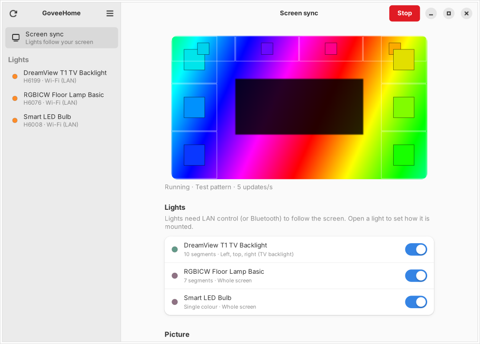
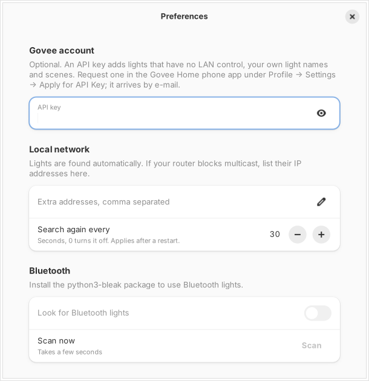

# GoveeHome for Linux

Govee only ships its Home app for phones and Windows, so on Fedora or any other Linux desktop
you're stuck picking up your phone every time you want to change a light. This is a native
GTK 4 app that controls Govee lights straight from the desktop, and it can make them follow
what's on your screen, like DreamView on the Govee PC app.



## What it does

- Finds your lights on the local network automatically (Govee LAN API, no account needed)
- Power, brightness, colour and white temperature
- **Screen sync**: lights take their colour from your screen. Lights with DreamView/Razer
  support get one colour per segment, so a TV backlight shows the left of the picture on the
  left and the top on the top. Everything else gets the overall colour.
- Works on Wayland (GNOME, KDE Plasma, through the screen share portal and PipeWire) and on X11.
  wlroots compositors like Sway and Hyprland are supported through `grim`.
- Optional: a Govee API key adds lights without LAN control, your own light names and scenes
- Optional: Bluetooth for lights without Wi-Fi
- A command line tool for scripts, keyboard shortcuts and running sync in the background

The Govee app's AI features (AI lighting bot, AI scene generation) are not part of this.

| Light | Preferences |
| --- | --- |
|  |  |

## Install

The short version, on Fedora:

```bash
git clone https://github.com/Vanquish1905/GoveeHome-For-Linux.git
cd GoveeHome-For-Linux
./install.sh
```

Then turn on **LAN Control** for each light in the Govee Home phone app (light settings,
toggle "LAN Control"). That switch is the step most people miss.

The full walkthrough, including Ubuntu, Arch, openSUSE, the firewall and how to set up
screen sync, is in **[SETUP.md](SETUP.md)**.

Requirements: Python 3.10+, GTK 4.10+, libadwaita 1.4+ (Fedora 39 or newer, Ubuntu 24.04 or
newer), PyGObject, numpy, and for Wayland capture the GStreamer PipeWire plugin.

## Command line

```bash
goveehome-cli list
goveehome-cli on "Desk lamp"
goveehome-cli color "TV backlight" "#ff7a00"
goveehome-cli color all 255 0 80
goveehome-cli brightness all 40
goveehome-cli temp 192.168.1.42 3000
goveehome-cli sync                      # until Ctrl+C
```

Targets can be a name (or part of one), an IP address, a device id, or `all`.
`--host 192.168.1.42` asks a light directly if multicast discovery doesn't reach it.

## How screen sync works

1. The screen is captured at a small size (160×90 is plenty for colours). On Wayland that
   goes through `xdg-desktop-portal`, so the desktop asks once which screen to share; the
   choice is remembered.
2. Each light gets zones on the screen depending on how it's mounted: the whole screen, the
   top edge, left/top/right for a TV backlight, columns for light bars, and so on.
3. Each zone's colour is picked ("Vivid" weights strong colours over grey areas), saturation
   and brightness are adjusted, and the result is smoothed so it doesn't flicker but still
   jumps on scene cuts.
4. Segment capable lights get a DreamView/Razer frame over UDP with one colour per segment.
   Other lights get a plain colour command, capped at 15 updates a second so they keep up.

Everything stays on your network. The cloud API is never used for sync; it's rate limited
and far too slow.

## Development

```bash
python3 -m goveehome            # run from the checkout
python3 -m pytest               # tests
python3 tools/fake_light.py --count 3   # pretend to be three lights on 127.0.0.x
```

With the fake lights running, the app and the CLI behave as if real lights were on the
network, and the fake lights print every command and streaming frame they receive. The test
pattern capture source (Screen sync → Capture → Source) is useful together with them.

Layout of the code:

```
goveehome/
  protocol/   lan.py (UDP API), razer.py (segment frames), ble.py, cloud.py
  capture/    portal.py (Wayland), x11.py, grim.py, pattern.py
  sync/       zones.py (screen layouts), colors.py (picking + smoothing), engine.py
  manager.py  device list, picks LAN / Bluetooth / cloud per light
  ui/         GTK 4 + libadwaita interface
  cli.py      goveehome-cli
```

Protocol notes are in [docs/PROTOCOL.md](docs/PROTOCOL.md).

## Prior work

These projects and docs made this possible and are worth a look:

- Govee's own [LAN API documentation](https://app-h5.govee.com/user-manual/wlan-guide) and
  [developer API](https://developer.govee.com/)
- [govee2mqtt](https://github.com/wez/govee2mqtt) (Home Assistant bridge, great notes on
  the LAN and cloud APIs)
- [homebridge-govee](https://github.com/homebridge-plugins/homebridge-govee) (Bluetooth and
  LAN command reference)
- The HyperHDR and Hyperion communities, for figuring out the DreamView streaming frames

None of them is a desktop app with screen sync for Linux, which is the gap this fills.

## Disclaimer

Independent project, not affiliated with or endorsed by Govee. "Govee" and "DreamView" are
trademarks of their owner and are only used to describe compatibility.

## License

Eclipse Public License 2.0, see [LICENSE](LICENSE).
