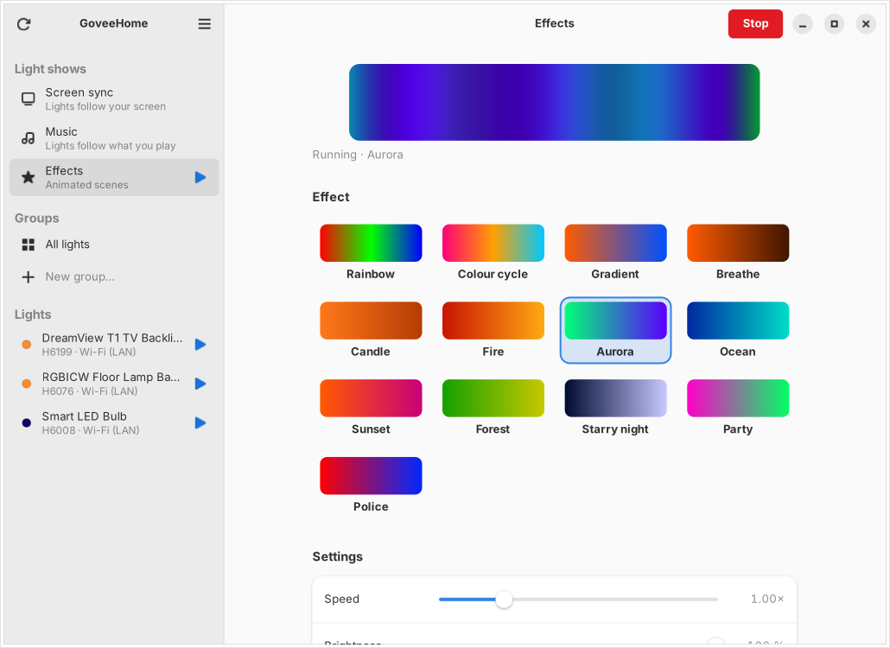
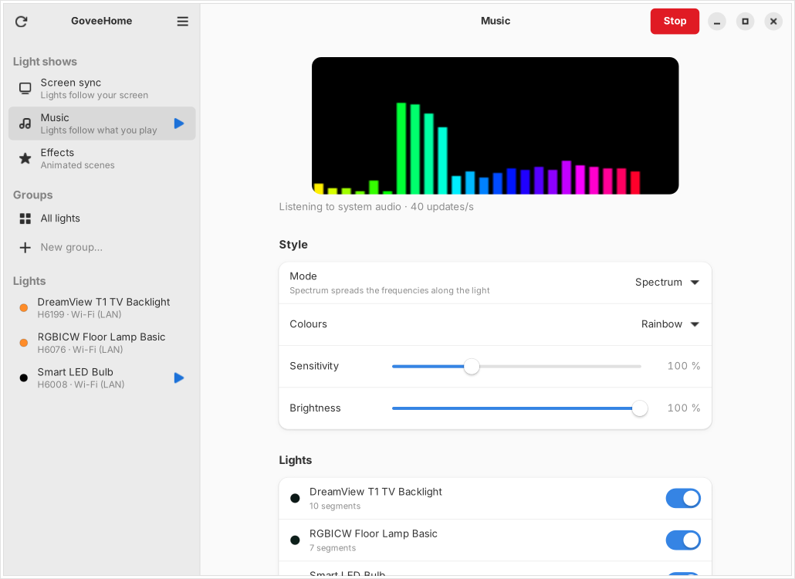
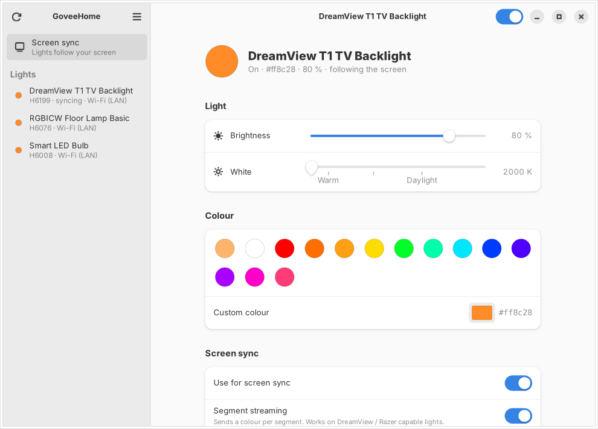
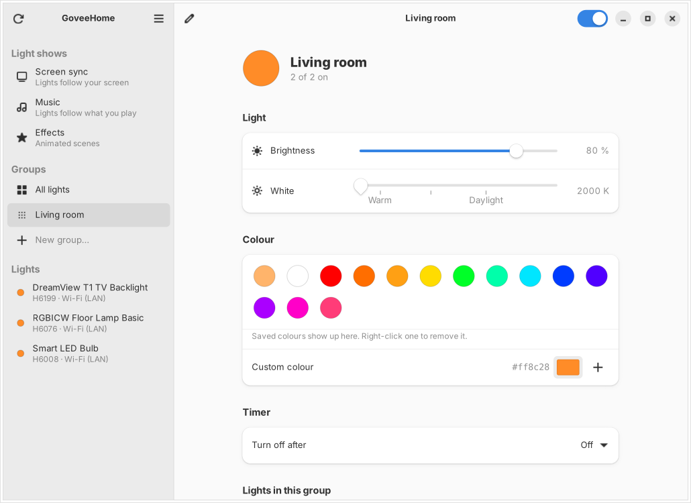

# GoveeHome for Linux

Govee only ships its Home app for phones and Windows, so on Fedora or any other Linux desktop
you're stuck picking up your phone every time you want to change a light. This is a native
GTK 4 app that controls Govee lights straight from the desktop and makes them follow your
screen and your music, like DreamView and music mode in the Govee PC app.


## What it does

**Control**
- Finds your lights on the local network by itself (Govee LAN API, no account needed)
- Power, brightness, colour, white temperature, saved colours and sleep timers
- Groups, plus an *All lights* group

**Screen sync**: the lights take their colours from your screen
- Segment capable lights (TV backlights, light bars, RGBIC strips, ...) get one colour per
  segment from the part of the screen they sit next to; other lights get the colour of
  their zone
- Mounting presets for TV and monitor backlights, single edges, columns and light bar pairs
  like the H6056 Flow Plus (one bar on each side of the screen)
- *Follow the video*: when a film or game runs in a window, the lights take their colours
  from it instead of the white page or desktop around it
- A *colour test* that finds out whether a light understands segment streaming or only
  plain colours, and sets it up accordingly
- *Check capture colours*: shows red, green and blue on the screen, checks they are captured
  as such, and corrects captures that swap colour channels (a KDE Plasma bug)
- An *Identify* test that shows on the light which side of the screen each segment follows,
  and a live colour strip per light showing exactly what it is being sent
- Colours that match: every screen pixel counts, mixing happens in linear light and the
  result is gamma corrected for LEDs; per-light white balance on top
- *Vividness*, like Saturation in Govee's own PC app: screen colours are turned into clean
  light colours. That matters a lot for lights with white LEDs (RGBWW / RGBICWW, like the
  H6056), which otherwise show every mixed colour as white
- Fast: in testing on X11, about 35 ms from a change on the screen to the command leaving
  the PC; glitch frames are filtered out and films with black bars are handled
- Works on Wayland (GNOME, KDE Plasma) through the screen share portal, on X11, and on
  Sway/Hyprland through `grim`. On KDE it asks for plain RGB frames, respects KWin's buffer
  limit, and a *colour boost* restores the colour of the washed-out picture KDE delivers
  when HDR is on

**Music sync**: the lights react to whatever the PC plays, straight from the audio output
(no microphone). Six modes (spectrum, mirrored spectrum, energy, beat pulse, bass glow,
rolling) and 25 colour palettes, including your own colours.

**Effects**: 102 effects rendered on the PC, no cloud needed, with live animated previews on
the effects page:
- *Animated* (42): moving, multi-coloured animations like juggle, bouncing balls, ripple,
  confetti, meteor shower, colour rain, pacifica, fireflies, hyperspace, plasma ball,
  kaleidoscope, galaxy, stained glass, disco ball, comets in five colours and colour flows
- *Moods* (16): slowly flowing colour worlds like peacock, unicorn, synthwave, northern
  lights, glacier, cherry blossom and autumn
- *Colourful*, *Your colours*, *Nature* and *Party and seasons*: rainbow, plasma, fire,
  candle, lava lamp, aurora, thunderstorm, snowfall, sunrise alarm, fireworks, Christmas,
  Halloween, Valentine, New Year and more
- Speed, brightness, size, direction and up to three of your own colours

**For every light show you choose which lights take part**, one by one, all at once or by
group.

**Around it**
- Keeps running in the background, starts at login, turns the lights off when the PC sleeps
  or shuts down and back on when it wakes
- Updates itself from GitHub: the app tells you when there's a new version and installs it
- Optional Govee API key: lights without LAN control, your own light names, scenes and DIY
  scenes, single-segment colours and the lights' own microphone music modes
- Optional Bluetooth for lights without Wi-Fi
- A command line tool for scripts, keyboard shortcuts and running light shows as a service

The Govee app's AI features (AI lighting bot, AI scene generation) are not part of this.

| Effects | Music |
| --- | --- |
|  |  |
| **A light** | **A group** |
|  |  |

## Install

On Fedora:

```bash
git clone https://github.com/Vanquish1905/GoveeHome-For-Linux.git
```

```bash
cd GoveeHome-For-Linux
```

```bash
./install.sh
```

Then turn on **LAN Control** for each light in the Govee Home phone app (light settings,
toggle "LAN Control"). That switch is the step most people miss.

Already installed? Use *Check for Updates…* in the app menu, or see
[Updating](SETUP.md#12-updating).

The full walkthrough, including Ubuntu, Arch, openSUSE, the firewall, setting up screen sync
and getting the colours right, is in **[SETUP.md](SETUP.md)**.

Requirements: Python 3.10+, GTK 4.10+, libadwaita 1.4+ (Fedora 39 or newer, Ubuntu 24.04 or
newer), PyGObject, numpy, Pillow and GStreamer with the base, good and PipeWire plugins. The
installer takes care of all of it.

## Lights

Any Govee light with *LAN Control* works for control and light shows. Models the app knows
get the right segment count and mounting preset out of the box, among them:

| Kind | Models |
| --- | --- |
| TV / monitor backlights | H6199, H6198, H6097, H6168, H604A, H604B, H604C, H66A0, H66A1, H61B2 |
| Light bar pairs | H6046, H6047, H6056, H6057 |
| Strips | H618A–H618F, H619A–H619Z, H61A0–H61A8, H61BA–H61BE, H61C3/C5, H61D3/D5, H61E0/E1, H6609, H6608 |
| Lamps and panels | H6072, H6076, H6078, H607C, H6061–H6069, H610A, H610B |
| Bulbs and others | H6008, H6009, H600D, H6052, H6022, outdoor lights and more |

Segment streaming is switched on by default only where it's known to work (DreamView
backlights, light bars, gaming strips). For any other light, run the *colour test* on its
page once: if the light understands streaming, it gets one colour per segment, otherwise it
gets one strong colour. Anything not in the table shows up as "Govee H…" with safe
defaults; set the segments and mounting on the light's page and use *Identify* to check them. With an API key, the segment count comes
from your Govee account.

## Command line

```bash
goveehome-cli list
goveehome-cli on "Desk lamp"
goveehome-cli color "TV backlight" "#ff7a00"
goveehome-cli color all 255 0 80
goveehome-cli brightness all 40
goveehome-cli temp 192.168.1.42 3000
goveehome-cli sync                                  # screen sync until Ctrl+C
goveehome-cli sync "Flow Plus" "TV"                 # only these lights
goveehome-cli music --mode mirror --palette neon
goveehome-cli music --colors "#ff0050;#00b4ff"      # your own colours
goveehome-cli effect list
goveehome-cli effect aurora --speed 0.5
goveehome-cli effect meteor --color "#ff2000" --size 40 --reverse
goveehome-cli diagnose                              # check screen capture, its colours and the lights
goveehome-cli test-light all                        # find out how each light takes colours
goveehome-cli update                                # install the newest version from GitHub
```

Targets can be a name (or part of one), an IP address, a device id, or `all`.
`--host 192.168.1.42` asks a light directly if multicast discovery doesn't reach it.

## How screen sync works

1. **Capture.** On Wayland the screen comes through `xdg-desktop-portal` and PipeWire, on X11
   through X shared memory, both in a GStreamer pipeline. A leaky queue makes sure only the
   newest frame is ever processed, so delay can't build up. Lanczos scaling shrinks the
   frame to 640×360 using every screen pixel, then it's averaged down to 160×90.
2. **Find the picture.** If the capture comes out washed out (KDE with HDR, pale content),
   its saturation is restored first. A single black frame (which capture sometimes produces) is ignored,
   so the lights don't flash off. The app tracks where the picture moves; when a video plays
   in a window, the zones are laid over the video instead of the whole screen, so the white
   page around it doesn't turn the lights white. Letterbox bars of films are cut off.
3. **Zones.** Each light gets one zone per segment, depending on how it's mounted.
4. **Colour.** Within each zone the app looks for the strongest colour family: pixels are
   grouped by hue and weighted by how saturated and bright they are, and only the winning
   group is averaged (in linear light). Averaging everything would turn a colourful picture
   into grey, because different colours cancel out, and white pages wash it out further. A
   zone that really is white or grey stays that way. Lights that can only show one colour
   get the strongest colour of all their zones the same way.
5. **Vividness.** Picture colours are rarely pure: skin, sky and grass have all three
   channels on. Lights with white LEDs show that shared part as white, so they look pale or
   white. Like Govee's own sync, the saturation is pushed towards pure colours while grey
   and white stay neutral and brightness is kept.
6. **Smoothing.** Time based, 40 ms by default, and big jumps like scene cuts go through at
   once.
7. **Output.** Colours are gamma corrected for LEDs and white balanced per light. Segment
   capable lights get a DreamView/Razer frame over UDP with one colour per segment; the
   streaming mode is switched on once, not over and over. Other lights get a plain colour
   command, capped at 15 per second.

Everything stays on your network. The cloud API is never used for light shows; it's rate
limited and far too slow.

## Development

```bash
python3 -m goveehome                      # run from the checkout
python3 -m pytest                         # tests
python3 tools/fake_light.py --count 4     # pretend to be four lights on 127.0.0.x
```

With the fake lights running, the app and the CLI behave as if real lights were on the
network (a TV backlight, H6056 light bars, a bulb and a neon strip), and the fake lights
print every command and streaming frame they receive. The test pattern capture source
(Screen sync → Capture → Source) is useful together with them.

Layout of the code:

```
goveehome/
  protocol/   lan.py (UDP API), razer.py (segment frames), ble.py, cloud.py
  capture/    gst.py (shared GStreamer pipeline), portal.py (Wayland), x11.py, grim.py, pattern.py
  sync/       engine.py (light show loop), zones.py (screen layouts), colors.py (colour picking,
              gamma, smoothing), letterbox.py, music.py, effects.py, palettes.py
  manager.py  device list and groups, picks LAN / Bluetooth / cloud per light
  skus.py     what the app knows about each model
  power.py    follows sleep / shutdown through logind
  updater.py  checks GitHub and installs new versions
  ui/         GTK 4 + libadwaita interface
  cli.py      goveehome-cli
```

Protocol notes are in [docs/PROTOCOL.md](docs/PROTOCOL.md).

## Prior work

These projects and docs made this possible and are worth a look:

- Govee's own [LAN API documentation](https://app-h5.govee.com/user-manual/wlan-guide) and
  [developer API](https://developer.govee.com/)
- [govee2mqtt](https://github.com/wez/govee2mqtt) (Home Assistant bridge, great notes on
  the LAN and cloud APIs)
- [homebridge-govee](https://github.com/homebridge-plugins/homebridge-govee) (Bluetooth and
  LAN command reference)
- The HyperHDR and Hyperion communities, for figuring out the DreamView streaming frames
- [govee-h6056](https://tessl.io/registry/jbaruch/govee-h6056) notes on the H6056 segment
  layout

None of them is a desktop app with screen sync for Linux, which is the gap this fills.

## Disclaimer

Independent project, not affiliated with or endorsed by Govee. "Govee" and "DreamView" are
trademarks of their owner and are only used to describe compatibility.

## License

Eclipse Public License 2.0, see [LICENSE](LICENSE).
